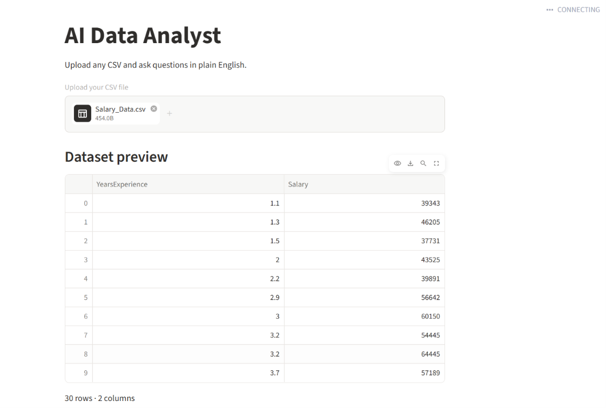
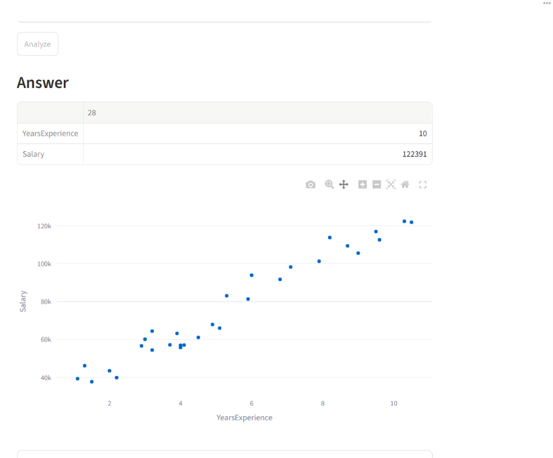

# AI Data Analyst

Upload any CSV file, ask a question in plain English, and get a calculated answer, an optional chart, and a simple explanation. It runs fully on your own computer using a free local AI model, so there are no API costs and your data stays private.

## Demo




## Features

- Upload any CSV (sales, HR, medical, and so on)
- Automatic statistical summary and missing-value count
- Ask questions in plain English
- The AI writes pandas code, runs it, and retries if it fails
- Shows the exact code that was run, so you can verify the answer
- Charts with Plotly
- Plain-English summary: answer, key points, and a caution

## Tech stack

Python, Streamlit, Pandas, Plotly, Ollama (llama3.2)

## How to run

1. Install Python 3.9 or higher
2. Install Ollama from https://ollama.com and download the model:
   ```
   ollama pull llama3.2
   ```
3. Install the packages:
   ```
   pip install -r requirements.txt
   ```
4. Start the app:
   ```
   streamlit run app.py
   ```
5. Open http://localhost:8501, upload `sales.csv`, and ask a question.

## Example questions

- Which category has the highest sales?
- Show sales by region as a bar chart
- What is the average sales per month?

## Limitations

- The AI writes and runs code, so use this only locally with your own files. Do not deploy it publicly for strangers.
- A small local model can sometimes write wrong code or misread a question. Always check the "Show the code that was run" section.
- Each question is answered on its own (no follow-up memory yet).

## Credits

Inspired by the tutorial "Build an AI Data Analyst That Turns CSV Files into Insights" by Aman Kharwal (amanxai.com). This version extends it with flexible AI-written pandas code, a retry loop, and a structured summary.